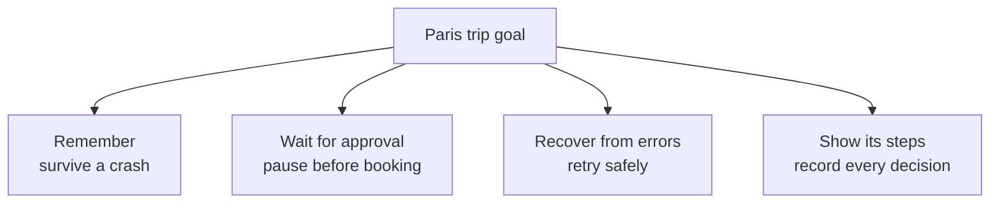
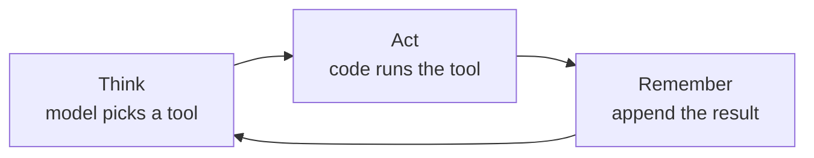

The Paris request now becomes a real business task:

> I am Marco Polo, employee e-4471, grade L4, from Mumbai. Book my outbound flight and a three-night hotel stay in Paris next week, within policy and ₹1,50,000, after my manager approves.

Earlier chapters showed how an agent can search, check policy, and replan. A deployed agent needs four more abilities.

## The four reliability needs



| Need | What it means for the trip |
| --- | --- |
| **Remember** | Keep the plan and budget even if the program crashes. |
| **Wait for approval** | Stop before booking and continue after the manager says yes. |
| **Recover from errors** | Retry a failed search, but never book twice. |
| **Show its steps** | Record each decision so the plan can be checked later. |

:::note Analogy
A paper travel form does not disappear when the travel desk closes for the night. It waits on the manager's desk. The next morning, work continues from the same form.

A reliable agent needs the digital version of that form: saved state, a clear pause point, and a record of what happened.
:::

## A hand-written agent loop

The basic loop is still useful:

```python
history = []

for step in range(MAX_STEPS):
    action = model.choose_next_action(history)  # think
    result = run_tool(action)                   # act
    history.append(result)                      # remember

    if action.name == "finish":
        break
```



This can plan a trip in one running Python process. It is not yet ready to handle real money.

## What the loop still cannot do

### 1. Survive a restart

`history` lives in process memory. If the server stops, the policy, fare shortlist, and remaining budget disappear.

### 2. Pause and resume

The loop can stop, but it has no durable place to wait four hours for a manager. Starting it again normally starts a new run.

### 3. Retry the right thing

A fare search timeout and an invalid travel date are different problems:

- A timeout may be retried.
- A wrong date should be corrected.
- A booking must not be repeated blindly.

One broad `except` block cannot make those decisions safely.

### 4. Bound more than steps

A step counter prevents an endless loop, but production limits also include time, tokens, model calls, and money.

### 5. Replay a disputed decision

If the traveller asks, "Why did it choose this fare?", an in-memory list may not show the exact state, tool arguments, retries, and approval used at each step.

:::key
A hand-written loop proves the agent idea. Reliable execution needs saved state, explicit pause points, error-specific recovery, bounded work, and a replayable trace.
:::

## What goes wrong

- Treating in-memory history as durable memory.
- Retrying a booking the same way as a read-only search.
- Asking the manager to approve after the booking has already run.
- Logging only the final itinerary.
- Using `MAX_STEPS` as the only cost and time control.

## One-line summary

The agent loop supplies think, act, and remember; the next layers make that loop persistent, pausable, recoverable, bounded, and inspectable.

## Key terms

- **In-memory state** — Data that disappears when the running process stops.
- **Durable state** — Progress saved outside the process so another process can continue.
- **Pause and resume** — Stop at a known point, wait for input, and continue from that point.
- **Replay** — Inspect the exact steps and state changes from an earlier run.
- **Bounded run** — A run limited by steps, time, tokens, or cost.
