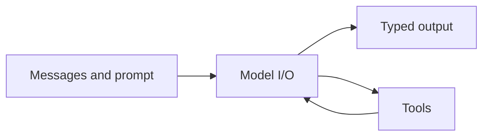
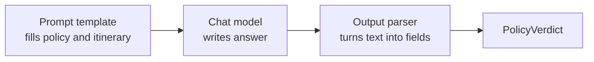

**LangChain** standardises the parts around a model call. Instead of inventing a new format for every provider and tool, the application uses a common set of building blocks.

## Three main building blocks



| Building block | What it does | Paris example |
| --- | --- | --- |
| **Model I/O** | Gives a common way to call providers such as Anthropic, OpenAI, or open-weight models without rewriting the application. | The travel assistant's model call |
| **Tools** | Declares callable functions with names, descriptions, and typed arguments. | `search_flights`, `search_hotels`, `check_policy` |
| **Messages and typed output** | Represents the conversation and validates the returned data. | A `PolicyVerdict`, not prose that code must guess how to read |

The common interface makes provider changes smaller. It does not guarantee that two models behave exactly the same.

## Tools: declare once, use anywhere

A tool is an ordinary function with enough information for the model and application to use it safely.

```python
from langchain.tools import tool

@tool
def search_flights(
    origin: str,
    destination: str,
    max_price: int,
) -> list:
    """Find flights below max_price. Search only; do not book."""
    ...
```

From that declaration, the framework gets:

- **Name** — `search_flights`
- **Argument schema** — `origin`, `destination`, and `max_price`, with types
- **Description** — what the tool does and when it should be chosen

The tool still needs application-side validation and permissions. A decorator does not make a function safe.

### Other capabilities can look like tools

- A **retriever** can become a policy-search tool.
- An **MCP server** can expose its tools.
- Another **agent** can be called through one tool-like interface.

## Structured output: answers become data

Free text is easy for a person to read:

> The itinerary looks mostly fine, although the departure may be a little close to the travel date under section 5.

Code still does not know whether that means pass or fail.

A typed result makes the decision clear:

```python
from pydantic import BaseModel

class PolicyVerdict(BaseModel):
    compliant: bool
    violated_clause: str | None
    reason: str
```

```json
{
  "compliant": false,
  "violated_clause": "§5.1",
  "reason": "Departs in 5 days; policy needs 7"
}
```

Now the graph can route to **replan** without decoding a paragraph.

Typed output helps because:

- A failed check becomes a field.
- A malformed result fails immediately.
- Tool calling and typed output can be used in the same model call.
- In strict provider mode, the model provider can enforce the schema through a provider strategy.

:::note Simple meaning
A schema is a form with named boxes. The model must put the answer into those boxes instead of returning any paragraph it likes.
:::

## Runnables: components that snap together

LangChain components share common operations:

| Operation | Meaning |
| --- | --- |
| `invoke` | Send one input and receive one output. |
| `batch` | Process many inputs. |
| `stream` | Receive output as it arrives. |

The pipe operator can form a chain:

```python
policy_chain = prompt | model | parser
verdict = policy_chain.invoke(
    {"policy": policy_text, "itinerary": trip}
)
```



## Where a chain stops

A chain moves data one way, from left to right.

It does not naturally express:

- Search again after a failed policy check.
- Pause before a booking.
- Save progress and continue in another process.
- Choose among several next steps from the latest state.

That missing control-flow layer is where LangGraph enters.

:::key
LangChain gives common model, tool, message, output, and runnable interfaces. A one-way chain is useful, but a reliable agent also needs loops, branches, pauses, and saved state.
:::

## What goes wrong

- Assuming a common model interface makes all providers identical.
- Giving the model a tool with a vague description.
- Parsing important policy decisions from loose prose.
- Treating schema validation as business-rule validation.
- Forcing a looping task into one long left-to-right chain.

## One-line summary

LangChain supplies reusable model and tool components; typed output makes decisions machine-readable, while runnable chains handle straight-line flows.

## Key terms

- **Model I/O** — A common interface for calling different model providers.
- **Tool** — A named callable capability with typed arguments and a description.
- **Structured output** — A model result validated against a known schema.
- **Runnable** — A component that supports common operations such as invoke, batch, and stream.
- **Chain** — A one-way sequence of runnable components.
