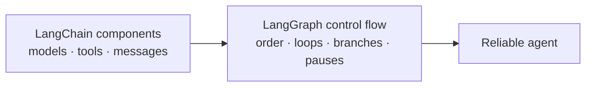
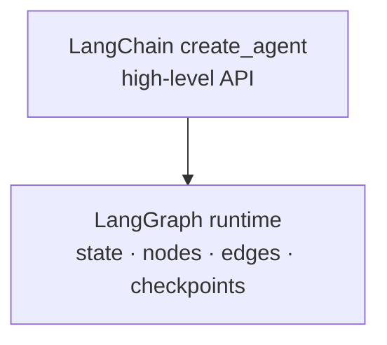

Models, tools, and messages tell us **what can run**. A reliable agent also needs to decide **what runs next**.

## The missing piece: control flow

The Paris agent must answer four questions:

| Control question | Paris example |
| --- | --- |
| **In what order?** | Retrieve policy first, or search fares first? |
| **Which steps repeat?** | Search again after a compliance failure—but how many times? |
| **Where does it pause?** | Before `book_flight` spends ₹34,900. |
| **Where does it resume?** | When approval arrives four hours later in another process. |



**LangGraph** is the control-flow layer. It makes the route visible as nodes and arrows instead of hiding the whole loop inside one agent call.

:::note Analogy
LangChain gives a kitchen its cooks, ingredients, and equipment.

LangGraph is the order board: prepare the starter first, cook independent dishes together, send a failed plate back, and wait before serving a meal that needs approval.
:::

## How chains grew into graphs

| Time | Change |
| --- | --- |
| **October 2022** | LangChain arrived before ChatGPT, focused on model I/O and chains such as retrieve-then-generate. |
| **December 2022** | A general-purpose agent added the ReAct pattern. |
| **February 2024** | LangGraph introduced explicit, inspectable, persistent control flow. |
| **October 2025** | LangChain 1.0 and LangGraph 1.0 shipped together; agents were consolidated onto LangGraph. |
| **2026** | LangGraph 1.1–1.2 added typed streaming, node timeouts, and error handlers; LangChain 1.4 built in MCP support. |

These version details describe the deck's timeline. APIs continue to change, so production code should always check the installed version's official documentation.

## Two levels of control

### LangChain agents: high-level API

- Prebuilt agent behaviour
- Built on LangGraph
- `create_agent` can start with a model, tools, and a system prompt
- Less code, with some control hidden behind the API

```python
from langchain.agents import create_agent

agent = create_agent(
    model=model,
    tools=[search_flights, search_hotels],
    system_prompt="Plan a policy-compliant trip. Never book.",
)
```

### LangGraph: low-level orchestration

- Define the graph, state, and execution yourself.
- Control every node and edge.
- Write more code in return for more flexibility.



`create_agent` is not a competing runtime. Underneath, it is a LangGraph graph.

## Which level should you choose?

| Need | Good starting point |
| --- | --- |
| A standard model-and-tools agent | LangChain `create_agent` |
| Exact routes, pause points, or state rules | LangGraph |
| Fast prototype with standard middleware | LangChain agent |
| A custom multi-agent or recovery flow | LangGraph |

Start high-level when its defaults match the task. Move lower only when you need control that the simple API does not expose clearly.

:::key
LangChain standardises the components. LangGraph orchestrates when they run, what repeats, where execution pauses, and how it continues.
:::

## What goes wrong

- Choosing LangGraph only because a graph diagram looks advanced.
- Using a one-way chain for a task that must replan.
- Assuming `create_agent` is unrelated to LangGraph.
- Dropping to low-level orchestration before defining the goal and state.
- Copying version-specific code without checking the installed version.

## One-line summary

Chains move data forward; graphs make loops, branches, pauses, and resumable control flow explicit.

## Key terms

- **Control flow** — The rules that decide which step runs next.
- **High-level API** — A simpler interface that provides useful defaults.
- **Low-level orchestration** — Direct control over state, nodes, edges, and execution.
- **ReAct** — A pattern that alternates reasoning, action, and observation.
- **Persistent** — Saved outside one running process so work can continue later.
