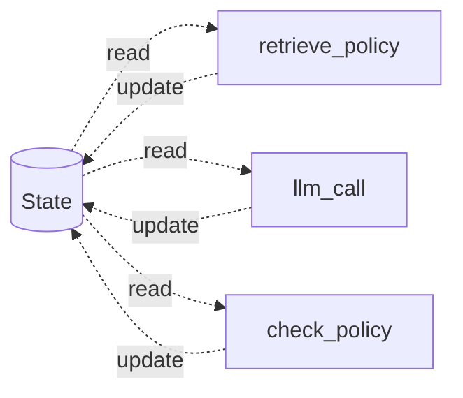
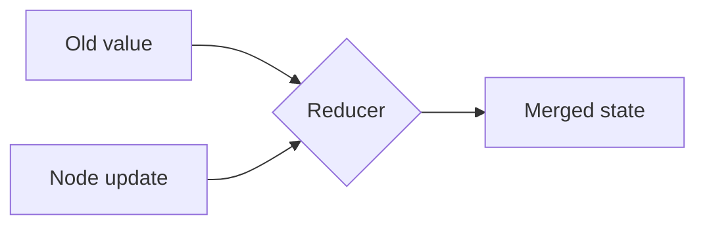
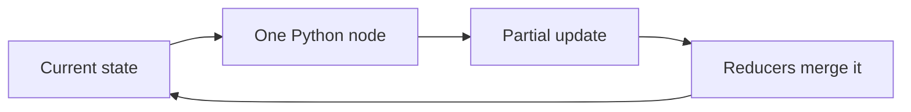

A LangGraph agent can be understood through four ideas:

1. **State** — what the run knows.
2. **Nodes** — small jobs that read and update state.
3. **Edges** — rules that choose the next job.
4. **Checkpointer** — saves state after each step.

This lesson starts with state and nodes. Edges and execution come next.



## State: one shared record

The Paris run needs one typed record of everything it knows so far.

| Field in `TripState` | What it holds | Merge rule |
| --- | --- | --- |
| `messages` | Conversation so far | Append |
| `budget_left` | Rupees still unspent | Overwrite |
| `policy_clauses` | Retrieved policy text | Accumulate |
| `candidates` | Flight and hotel options | Accumulate |
| `attempts` | Replans so far | Add one |
| `verdict` | Latest compliance result | Overwrite |

One moment in the trip might look like this:

```text
budget_left: ₹45,100
candidates: AI142 · Hotel Lumière
verdict: FAIL · §5.1
```

## The reducer is the important part

A **reducer** says how a new value joins the old value.



By default, a new value replaces the old one. Some fields need another rule:

- Messages should **append**, not erase the conversation.
- Candidate lists should **accumulate**, not keep only the latest search.
- Attempt counts should **add**, not replace the previous count with `1`.

A small typed-state example:

```python
import operator
from typing import Annotated, TypedDict
from langgraph.graph.message import add_messages

class TripState(TypedDict):
    messages: Annotated[list, add_messages]
    budget_left: int
    candidates: Annotated[list, operator.add]
    attempts: Annotated[int, operator.add]
    verdict: dict | None
```

The annotation is the merge rule. It prevents two useful updates from silently overwriting each other.

:::note Analogy
Think of a shared trip spreadsheet.

Typing a new remaining budget should replace the old number. Adding a flight candidate should create a new row, not delete all earlier rows. A reducer is simply the rule for each column.
:::

## Nodes: plain Python functions

A node:

1. Reads the current state.
2. Does one job.
3. Returns only the fields that changed.

```python
def retrieve_policy(state: TripState) -> dict:
    clauses = policy_retriever.invoke(state["messages"][-1])
    return {"policy_clauses": clauses}
```

The node does **not** copy and return the whole state. LangGraph merges its partial update using the reducers.

## Three Paris nodes

| Node | Reads | Returns |
| --- | --- | --- |
| `retrieve_policy` | Goal | Cabin rule and hotel cap |
| `llm_call` | Messages | One new model message, possibly with tool calls |
| `tool_node` | Tool calls in the last message | One result message per tool |



`retrieve_policy` may contain a complete RAG pipeline, but the graph sees it as one node with one input and one update.

:::key
State records what the run knows. Nodes do one job and return only changes. Reducers define exactly how those changes join the shared record.
:::

## What goes wrong

- Returning the whole state from every node.
- Appending a budget when it should be replaced.
- Replacing a candidate list when it should accumulate.
- Letting merge behaviour depend on whichever assignment runs last.
- Putting policy retrieval, model reasoning, tool execution, and booking in one giant node.

## One-line summary

LangGraph state is a typed shared record; small nodes return partial updates, and reducers merge those updates without accidental data loss.

## Key terms

- **State** — The typed record of what one graph run currently knows.
- **Node** — A function that reads state, does one job, and returns an update.
- **Partial update** — Only the fields changed by a node.
- **Reducer** — The rule for merging a new field value into existing state.
- **Typed state** — State whose fields and expected value shapes are declared.
