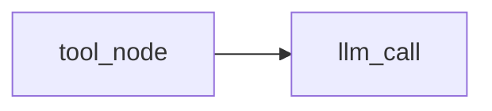
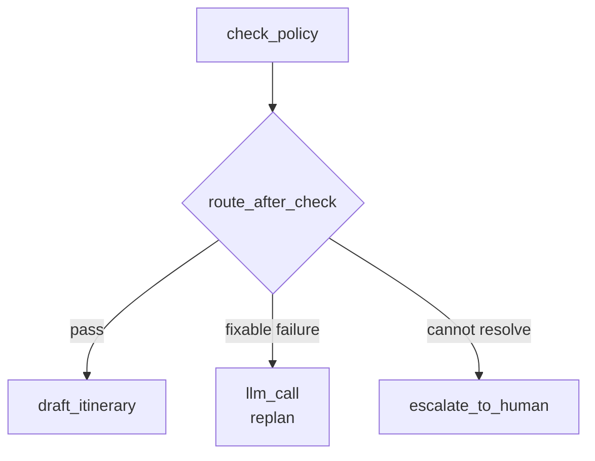
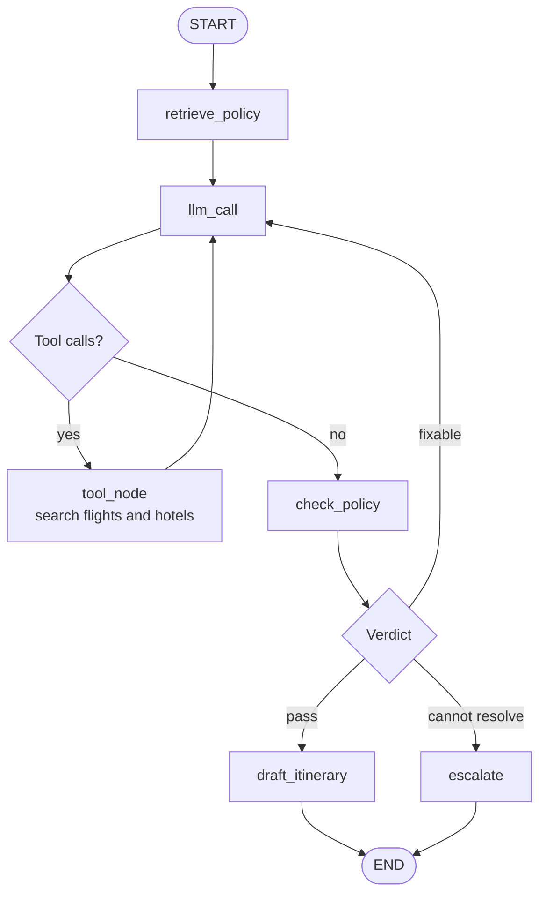
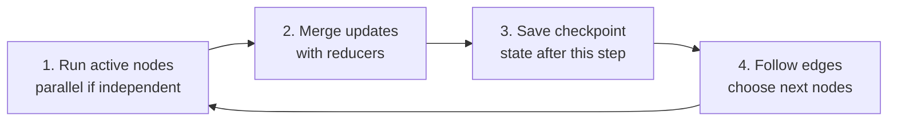

Nodes describe the work. **Edges** decide what runs next.

## Fixed and conditional edges

### Fixed edge

A fixed edge is always followed.



After tools return their observations, the model always reads them.

### Conditional edge

A conditional edge reads state and chooses a route.



The routing function does not need to solve the trip. It only needs to turn the latest verdict into a route name.

```python
def route_after_check(state: TripState) -> str:
    if state["verdict"]["compliant"]:
        return "draft"
    if state["attempts"] < 3:
        return "replan"
    return "escalate"
```

## The travel agent as a graph



Read it in order:

1. **Fixed start** — every run retrieves policy, then calls the model.
2. **Tool loop** — model → tools → model while the model requests tools.
3. **Conditional exit** — no more tool calls sends control to the policy check.
4. **Verdict routing** — draft, replan, or escalate.
5. **End** — a completed draft or honest escalation stops the run.

`compile()` turns the declared shape into an agent that can run, be drawn, and be inspected.

```python
from langgraph.graph import END, START, StateGraph

builder = StateGraph(TripState)
builder.add_node("retrieve_policy", retrieve_policy)
builder.add_node("llm_call", llm_call)
builder.add_node("check_policy", check_policy)

builder.add_edge(START, "retrieve_policy")
builder.add_edge("retrieve_policy", "llm_call")
builder.add_conditional_edges("check_policy", route_after_check)

graph = builder.compile()
```

The full graph would also register the tool, draft, and escalation nodes. The short example only shows how nodes and edges fit together.

## How a graph runs: super-steps

A **super-step** is one round of graph execution.



Independent active nodes can run at the same time. Their updates are then merged before the graph moves forward.

## The Paris run, step by step

| Super-step | Active work |
| --- | --- |
| **1** | `retrieve_policy` |
| **2** | `llm_call` |
| **3** | `tool_node`: flights and hotels together |
| **4** | `llm_call` reads both results |
| **5** | `check_policy` returns fail and routes to replan |
| **6** | `llm_call` plans another attempt |

Each super-step ends with a saved checkpoint.

The run stops when:

- An edge reaches `END`, or
- `recursion_limit` is reached—for example, 25 super-steps.

The recursion limit is a safety ceiling, not a target.

:::key
Fixed edges express known order. Conditional edges route from the latest state. LangGraph runs active nodes, merges updates, saves a checkpoint, and follows edges one super-step at a time.
:::

## What goes wrong

- Hiding all routing inside the model prompt.
- Sending every failed check back into the loop with no escalation route.
- Forgetting `END`, so a finished task keeps moving.
- Treating `recursion_limit` as the only time or cost budget.
- Running dependent nodes together before the required state exists.

## One-line summary

Edges turn small nodes into a visible workflow, while super-steps make parallel work, merging, checkpoints, routing, and stopping explicit.

## Key terms

- **Fixed edge** — An always-followed route from one node to another.
- **Conditional edge** — A route selected from the current state.
- **Graph** — Nodes connected by explicit control-flow edges.
- **Super-step** — Run active nodes, merge updates, checkpoint, then choose the next nodes.
- **Recursion limit** — Maximum super-steps allowed before the graph stops.
