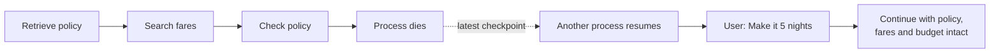
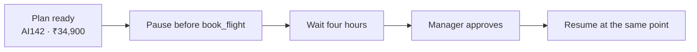
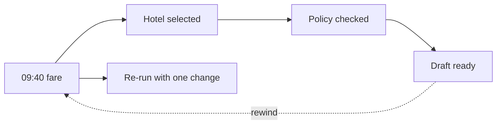

The fourth core LangGraph idea is the **checkpointer**.

A checkpointer saves state after each super-step. That saved history makes restarts, long approval waits, and inspection practical.

## Checkpoints and threads

A **thread** identifies one continuing run.

```text
thread_id = "trip-paris-2026-08"
```



The second process uses the same `thread_id`, loads the latest checkpoint, adds the new request, and continues.

```python
config = {
    "configurable": {
        "thread_id": "trip-paris-2026-08"
    }
}

graph.invoke(first_request, config)
# Later, another process can invoke the same thread.
graph.invoke(updated_request, config)
```

In production, checkpoints can live in a database such as Postgres. They do not depend on one server's memory, so the run can outlive that server.

:::note Thread versus conversation
A thread is the filing number on the Paris trip. Every saved version goes into the same file. The server handling the next step may change, but the filing number tells it which state to load.
:::

## Human-in-the-loop

Some nodes must wait for a person.



The graph does not restart the search after approval. It resumes from the paused state.

That matters because:

- The approved fare and budget remain visible.
- The approval is attached to the exact proposed action.
- The write tool does not run before approval.
- A different process can receive the approval and continue.

## Time travel

Each checkpoint is a state you can inspect.



**Time travel** means selecting an earlier checkpoint and running forward again with a change.

For example:

> Keep the 09:40 fare, change the hotel cap, and re-run from there.

This is useful for debugging and controlled corrections. It does not rewrite what happened in the real world. A ticket already issued by an airline still exists.

## Streaming

A long planning run should not look like a frozen screen.

LangGraph can stream:

| Stream | What the user or developer sees |
| --- | --- |
| **Tokens** | The model reply as it is written |
| **Updates** | Each node's change to state |
| **Custom events** | Progress messages emitted by application code |

```text
Retrieving policy…
Searching flights and hotels…
Checking the ₹1,50,000 budget…
Waiting for manager approval…
```

Streaming improves visibility. It does not make a slow dependency faster.

:::key
Checkpoints save progress; thread IDs connect the saved steps of one run; interrupts pause safely for people; time travel revisits an earlier state; streaming shows progress while work continues.
:::

## What goes wrong

- Generating a new thread ID when trying to resume an old trip.
- Saving checkpoints only in local process memory.
- Asking for approval without showing the exact action and amount.
- Rewinding state and assuming an earlier real-world booking was undone.
- Streaming raw private tool output directly to the user.

## One-line summary

Persisted checkpoints turn one graph run into a durable thread that can survive restarts, wait for approval, revisit earlier state, and show progress.

## Key terms

- **Checkpointer** — The component that saves graph state after steps.
- **Thread ID** — The identifier that links all checkpoints for one continuing run.
- **Interrupt** — A deliberate pause while the graph waits for approval or input.
- **Time travel** — Re-run from an earlier checkpoint with a change.
- **Streaming** — Sending tokens, state updates, or custom progress events as they happen.
