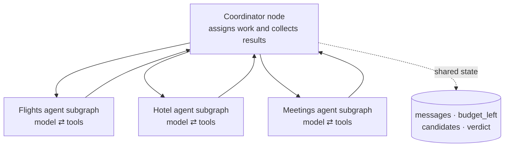
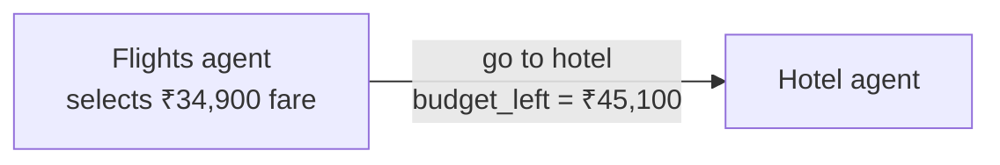
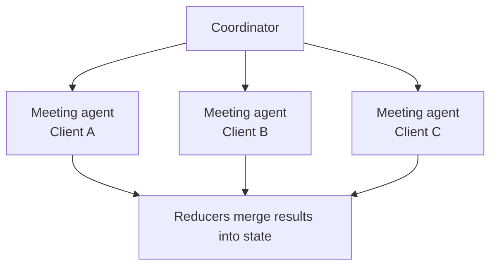

Chapter 4.5 designed a coordinator and specialists. LangGraph gives that design an explicit execution shape.

## A graph of graphs

Each specialist can be its own graph:



A specialist graph can be built and tested by itself, then added to the larger graph as one node.

This gives the team:

- One visible coordinator route.
- Reusable specialist subgraphs.
- One thread and one trace for the whole system.
- One place to resume after a crash.
- The same approval pause before `book_flight`, whichever specialist proposes it.

## Shared state or private state

Specialists do not always need the same visibility.

| State choice | Meaning | Good fit |
| --- | --- | --- |
| **Shared state** | Specialist reads and updates fields in the team's state. | Budget and final candidates |
| **Private state** | Specialist keeps its working notes inside its subgraph. | Raw search pages and discarded options |
| **Summary return** | Specialist exposes only a small result to the coordinator. | Top three fares with prices and times |

Private state keeps the top-level record smaller and reduces accidental coupling.

:::note Analogy
The coordinator sees the final quote from each travel desk. It does not need every browser tab, rejected fare, or scratch note each specialist used.
:::

## Handoff: control and data move together

A **handoff** sends the next agent both:

1. Where execution should go.
2. What state should change.



The hotel agent starts with the correct remaining budget because the route and update travel together.

Conceptually, the handoff result looks like this:

```python
return Command(
    goto="hotel_agent",
    update={"budget_left": 45_100},
)
```

The exact API depends on the installed LangGraph version. The design idea stays the same: routing and state change are one decision.

## Fan-out: parallel specialists

Some work is discovered only at run time.

Suppose the calendar contains three client meetings. The coordinator creates one branch per meeting:



The number of branches is not fixed in advance. It depends on how many meetings are found.

All branches can run at the same time because they are independent. Reducers merge their returned updates safely.

## Handoff versus fan-out

| Pattern | Shape | Paris example |
| --- | --- | --- |
| **Handoff** | One agent passes control to another. | Flights settles cost, then hotel uses the remaining budget. |
| **Fan-out** | One node creates several parallel branches. | One meeting-planning branch per client. |

Use a handoff when the next specialist depends on the first result. Use fan-out when subtasks are independent.

:::key
Multi-agent systems can be graphs of subgraphs. Handoffs move control and state together; fan-out creates independent branches at run time; reducers merge their results.
:::

## What goes wrong

- Giving every specialist the full top-level state.
- Returning raw internal notes instead of a small contract result.
- Starting the hotel branch before the flight budget is settled.
- Using sequential handoffs for independent client meetings.
- Letting different branches write the same field without an appropriate reducer.

## One-line summary

Build each specialist as a tested subgraph, use handoffs for dependent work, and fan out independent runtime tasks in parallel.

## Key terms

- **Subgraph** — A complete graph used as one node inside a larger graph.
- **Private state** — Working data kept inside one specialist.
- **Handoff** — Passing control and a state update to another agent.
- **Fan-out** — Creating several independent branches from one step.
- **Graph of graphs** — A multi-agent system made from reusable specialist graphs.
