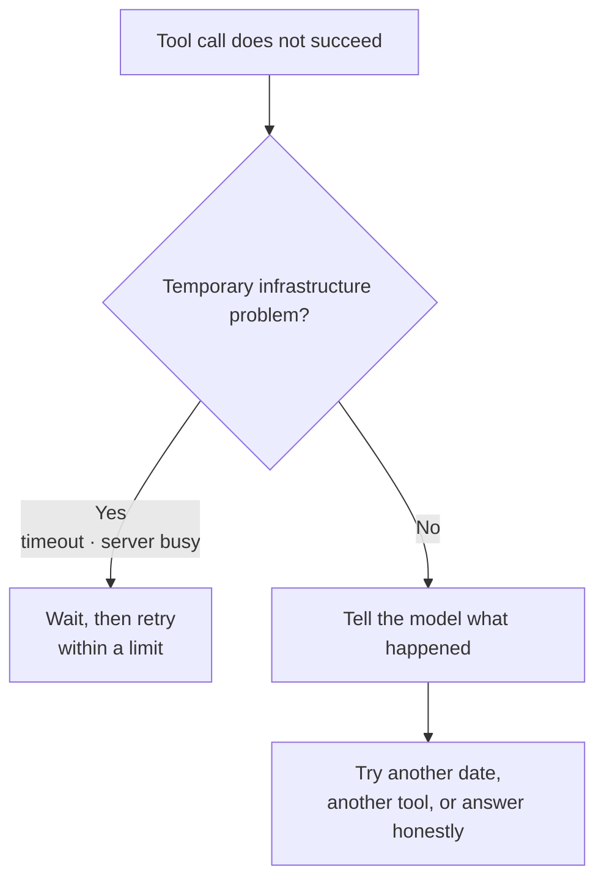
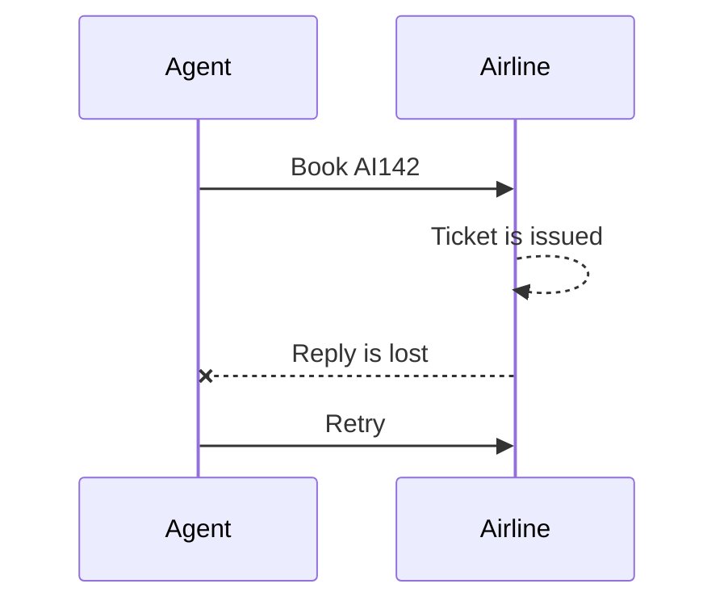
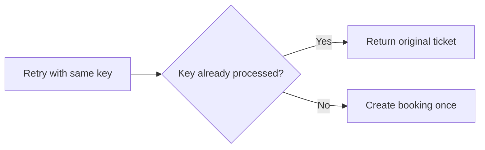
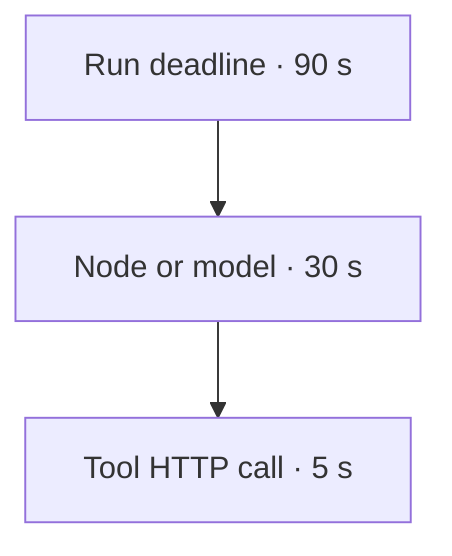
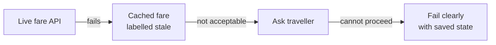

A graph can be correct on a whiteboard and still fail in production. Networks hang, credentials expire, fares disappear, and models make invalid calls.

## Six failure modes

| Failure | Paris example |
| --- | --- |
| **Tool hangs** | The fare API accepts the connection but never replies. |
| **Tool fails** | It returns 503, a rate limit, or an expired-credential error. |
| **Tool returns nothing useful** | There is no flight under ₹50,000 for that date. |
| **Model calls it wrong** | `date` is today, or `cabin="premium"` violates the allowed enum. |
| **Loop will not converge** | The agent switches between two fares forever. |
| **World moved** | A ₹34,900 fare found earlier is gone by the booking step. |

These are not one problem. Each needs a different response.

## Handle tool errors by meaning



### Temporary failure

A short outage or timeout may succeed on a limited retry.

### Semantic result

> No fares under ₹50,000.

This is not an exception. It is a fact the model must plan around.

### Permanent failure

An expired credential needs repair or escalation, not repeated calls.

Never let the run silently crash. If the model never receives the error, it may continue without evidence and invent a fare.

## Retry bookings safely

A search is read-only. A booking changes the world.



Without protection, the airline may see a second request and issue a second ticket.

Use an **idempotency key** such as:

```text
trip-paris-2026-08:AI142
```

On a retry with the same key, the airline can return:

> Already booked. Here is the same ticket.



Searches can often be retried freely. Bookings, payments, and emails need an idempotency key, human approval, or both.

## Timeouts: three nested clocks



| Clock | Scope | Example response |
| --- | --- | --- |
| **Tool timeout: 5 s** | One HTTP request, including connection | Name the stalled fare service and retry if allowed. |
| **Node/model timeout: 30 s** | One graph step | Raise a node timeout and apply its retry policy. |
| **Run deadline: 90 s** | Whole planning turn | Save a checkpoint and return what is settled so far. |

The smallest clock fires first and identifies the dependency that stalled.

The deck notes that LangGraph 1.2 supports a timeout on `add_node(...)`, raising `NodeTimeoutError` so the retry policy can run. Treat this as version-specific API behaviour.

## Fallbacks and graceful degradation

Use fallbacks in a declared order:



### Useful degraded answers

- **Cached fare, labelled stale** — "As of 09:15 today—verify before booking."
- **Ask the traveller** — "Fare search is down. Shall I hold yesterday's ₹38,400 option?"
- **Fail with state** — "Policy and hotel are settled; fares unavailable. Nothing booked."

Fallback chains can also apply to models:

```text
primary model → secondary model → small model
```

The next option runs only after the previous one fails. The deck notes that in LangGraph 1.2 a node `error_handler` can return a routing command to the fallback.

:::key
A degraded answer that declares itself can still help. A confident ₹45,000 fare that no tool returned is worse than an outage.
:::

## Bound the loop

Retries need:

- Maximum attempts
- Backoff between attempts
- A run deadline
- A recursion or step limit
- A route to human escalation

A retry policy solves temporary failure. It must not turn a permanent or semantic failure into an expensive loop.

## What goes wrong

- Retrying every failure, including bad credentials and "no results."
- Retrying a booking without an idempotency key.
- Setting a 90-second run deadline but no timeout on a hanging HTTP call.
- Showing stale data as if it were live.
- Falling back to an ungrounded model answer when the fare tool is down.
- Allowing retries and replanning to run without limits.

## One-line summary

Classify failures, retry only temporary ones, protect writes with idempotency and approval, nest timeouts, bound loops, and label every fallback honestly.

## Key terms

- **Transient failure** — A temporary infrastructure problem that may succeed later.
- **Semantic result** — A valid tool answer such as "no fares found."
- **Idempotency key** — A stable request key that prevents duplicate side effects.
- **Timeout** — A limit on how long one operation may wait.
- **Graceful degradation** — Provide a clearly labelled reduced service instead of inventing a normal result.
