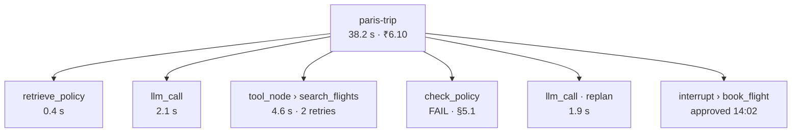
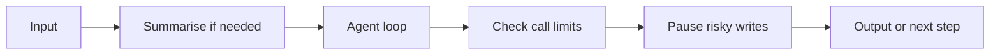

A reliable graph must be visible after it runs. A trace connects the final itinerary to the model calls, tools, retries, checks, and approval that produced it.

## One run as a trace tree

The Paris example appears as one parent run with smaller child steps:

**Langfuse** can record this hierarchy as a trace.

The top level answers:

- How long did the full trip run take?
- What did it cost?
- Did it complete?

The child steps answer:

- Which node was slow?
- Which tool retried?
- Which policy clause failed?
- Did replanning happen?
- Who approved the booking, and when?

## Trace first, then evaluate

A trace is evidence, not a passing score.

Useful checks for this run include:

| Check | Evidence in the trace |
| --- | --- |
| **Correct tool use** | `search_flights` ran with the intended trip constraints. |
| **Policy handling** | `check_policy` recorded `FAIL · §5.1`, then the graph replanned. |
| **Recovery** | The flight tool needed two retries and still stayed within its limit. |
| **Human control** | Booking waited at an interrupt and was approved at 14:02. |
| **Latency and cost** | Full run: 38.2 seconds and ₹6.10. |

Compare these fields across many test trips, not only one successful demo.

:::note Analogy
A parcel-tracking page shows every depot a package visited. A graph trace does the same for an agent: which node handled it, how long it stayed there, what changed, and where it went next.
:::

## Middleware: behaviour around the loop

**Middleware** adds reusable behaviour without rewriting the agent's main loop.

Examples from the chapter:

- Summarise old messages when context grows.
- Require human approval before selected tools.
- Limit model calls or tool calls.

The high-level `create_agent` API can plug in these behaviours while its underlying LangGraph graph continues to manage execution.

Middleware does not replace business controls. The booking service must still validate permissions and idempotency.

## Six things to carry forward

### 1. LangChain standardises components; LangGraph orchestrates them

`create_agent` is built on a LangGraph graph underneath.

### 2. A graph is state, nodes, and edges

Use typed state with reducers, plain Python nodes, and fixed or conditional edges.

### 3. Workflow patterns are ways of wiring edges

Chaining, routing, fan-out, and loops differ mainly in how control moves. Multi-agent systems are graphs of graphs.

### 4. Persisted state gives memory, resumption, and approval

Checkpoints per thread make restarts, human pauses, and time travel practical.

### 5. Middleware adds behaviour without rewriting the loop

Summarisation, approval, and call limits can wrap the agent.

### 6. Reliability decides whether an agent is deployable

Retry infrastructure failures, surface semantic results, bound loops, and protect write actions with stable keys.

:::key
Frameworks make control flow easier to build and inspect. They do not remove the need for clear state, permissions, bounded retries, honest fallbacks, or evaluation.
:::

## A beginner's build order

1. Make the goal and success condition explicit.
2. Declare narrow tools and typed outputs.
3. Define the smallest useful state.
4. Give each node one job.
5. Draw fixed and conditional edges.
6. Add checkpoints and a thread ID.
7. Pause before write actions.
8. Add error-specific retries, timeouts, and idempotency.
9. Trace the run and evaluate task success, cost, and recovery.

## What goes wrong

- Logging one flat string instead of a parent run with child steps.
- Measuring only the final answer and missing retries or policy failures.
- Treating middleware as a replacement for service-side permissions.
- Adding framework features before the state and routes are clear.
- Calling a demo production-ready because it completed once.

## One-line summary

Use traces to connect outcomes to every step, middleware for reusable controls, and the six core rules to keep LangChain and LangGraph agents understandable and deployable.

## Key terms

- **Trace** — The full recorded path of one run.
- **Span** — One timed operation inside a trace, such as a node or tool call.
- **Langfuse** — An observability and evaluation platform that can record agent traces.
- **Middleware** — Reusable behaviour that runs around model, tool, or agent operations.
- **Deployable** — Reliable enough to run with real users, data, and side effects.
